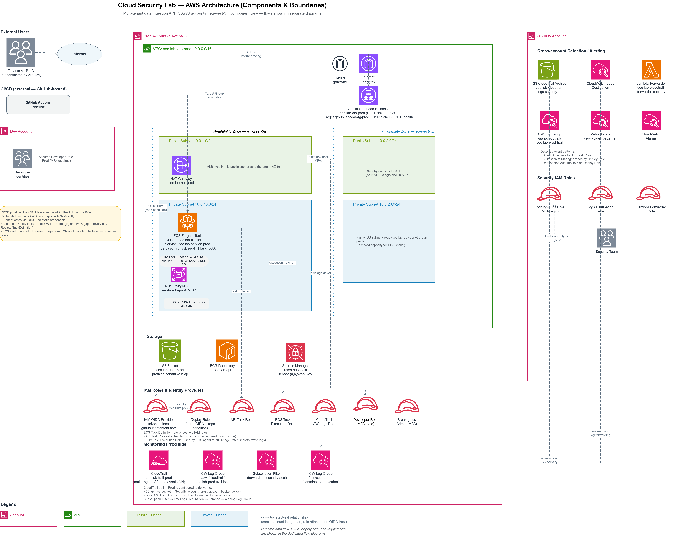
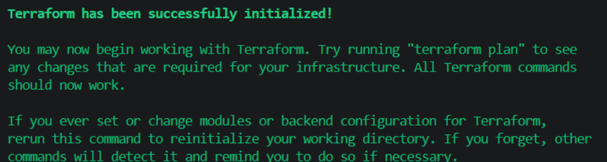
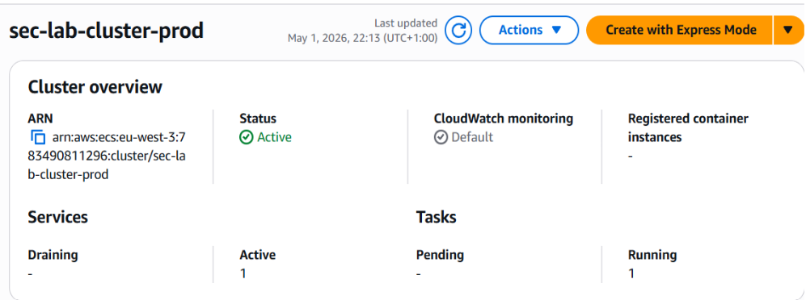
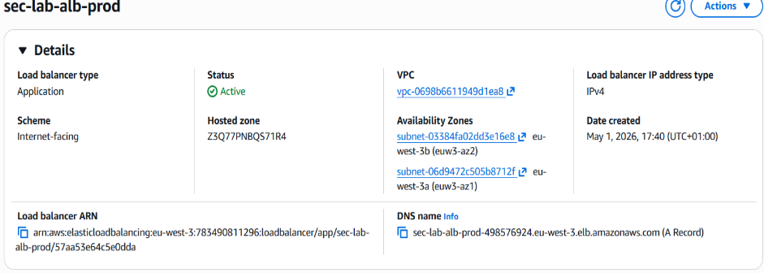
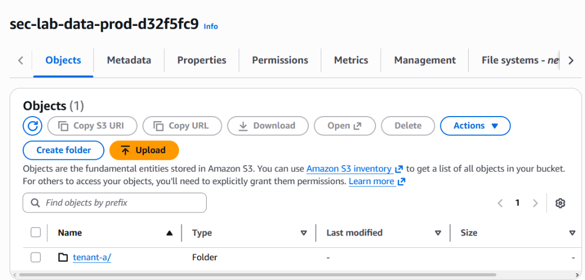
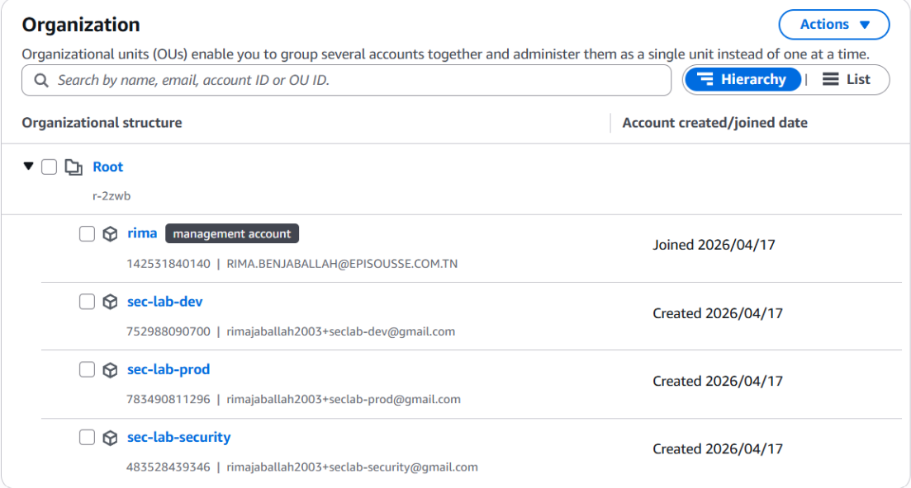

# Architecture

A cloud-native, multi-tenant data-ingestion platform on AWS. Tenants submit files through a public API; the platform authenticates each request, parses the file to extract metadata, stores the original in object storage, and records metadata in a database. The environment spans three AWS accounts to model a realistic separation of duties, and includes a dedicated detection layer.

> All identifiers in this repo (account IDs, ARNs, bucket suffixes, endpoints) are sanitized placeholders.

## Core application

A Python **Flask** API, containerized and running on **ECS Fargate** (port 8080) behind an **Application Load Balancer**. Tenants A, B, and C each authenticate with their own API key (`X-API-Key` header) stored in **Secrets Manager**. On upload the API:

1. Authenticates the tenant against Secrets Manager.
2. Parses the uploaded XML/SVG to extract metadata (record count, schema version, SVG dimensions).
3. Stores the raw file in **S3** under the tenant's prefix (`tenant-a/`, `tenant-b/`, `tenant-c/`).
4. Writes upload metadata to **RDS PostgreSQL**.

## Tenant isolation model

A **single** ECS task serves all three tenants, so the API task role must be able to read all three tenant API keys — IAM cannot scope Secrets Manager access per tenant. This mirrors how real multi-tenant SaaS platforms operate: one application identity with access to the credential pool it needs. Tenant isolation therefore lives at the **application layer** (the app reads the API key, resolves the tenant, and scopes every S3 operation to that tenant's prefix in code).

This is precisely why over-permissioning the task role with `s3:*` is catastrophic in Path 1: the application layer is the only boundary between tenants, and stealing the container credentials bypasses it entirely.

## Task Role vs. Task Execution Role

ECS Fargate uses two IAM roles per task:

- **API Task Role** — used by application code inside the container; reachable via the task credential endpoint at `169.254.170.2`. This is the identity stolen in Path 1.
- **ECS Task Execution Role** — used by the ECS agent to pull images from ECR, write logs, and inject the RDS secret at startup. Infrastructure-level; never visible to application code. Correctly configured.

## Accounts

| Account | What lives there |
| --- | --- |
| **Dev** | CI/CD pipeline identity, developer identities |
| **Prod** | VPC, ALB, ECS cluster/service/task, ECR, S3, RDS, Secrets Manager, IAM roles (API Task, Execution, Deploy, Developer, Break-glass), CloudTrail, prod-side CloudWatch log groups + subscription filter |
| **Security** | CloudTrail log archive (S3), CloudWatch Logs destination, Lambda forwarder, alerting log group, metric filters, alarms, audit role — intentionally isolated, no attack surface |

## Networking

One VPC (`10.0.0.0/16`, `eu-west-3`) with public subnets (ALB only) and private subnets (ECS + RDS). A single NAT gateway provides outbound access for private subnets. Security groups:

- **ALB SG** — inbound TCP 80 from anywhere; outbound TCP 8080 to ECS.
- **ECS SG** — inbound TCP 8080 from ALB. _Vulnerable state:_ outbound all traffic to `0.0.0.0/0` (enables Path 1 out-of-band exfiltration). _Hardened state:_ outbound HTTPS + PostgreSQL-to-RDS only.
- **RDS SG** — inbound TCP 5432 from ECS only.

## Detection layer (cross-account)

CloudTrail in prod delivers events to three destinations:

1. An **S3 archive bucket** in the security account (cold audit storage).
2. A **prod-local CloudWatch log group** (native CloudTrail integration).
3. A **security-account alerting log group** — fed by a subscription filter on the prod log group that forwards to a CloudWatch Logs **Destination**, which invokes a **Lambda forwarder** that decompresses events and writes them to the alerting group. (A Logs Destination cannot target a log group directly — only Lambda, Kinesis, or Firehose.)

**Metric filters and alarms live in the security account**, so an attacker in prod cannot disable them — only try to avoid tripping them. Three filters watch for: unexpected `AssumeRole` on the Deploy Role, direct S3 access by the API task role, and bulk Secrets Manager reads by the Deploy Role.

> During Path 2 testing, the Lambda forwarder's resource policy was found to specify the wrong `AWS:SourceAccount`, silently dropping all cross-account log delivery (finding **F5**). It was fixed permanently in Terraform. See [remediation.md](remediation.md).

## Resource naming

All resources follow `sec-lab-<component>-<env>` (e.g. `sec-lab-cluster-prod`, `sec-lab-data-prod-<suffix>`). S3 bucket names include a random suffix because the S3 namespace is global.

## Infrastructure parameters (reference)

| Parameter | Value |
| --- | --- |
| Region | `eu-west-3` (Paris) |
| VPC CIDR | `10.0.0.0/16` |
| ECS launch type | Fargate (256 CPU / 512 MB, awsvpc) |
| Container port | 8080 |
| ALB health check | `GET /health`, matcher 200 |
| S3 prefixes | `tenant-a/`, `tenant-b/`, `tenant-c/` |
| RDS | PostgreSQL `db.t3.micro`, 20 GB gp3, not publicly accessible |
| Secrets | `tenant-a/api-key`, `tenant-b/api-key`, `tenant-c/api-key`, `rds/credentials` |
| CloudTrail | multi-region, management + S3 data events on the tenant bucket |

## Proof it's deployed

The environment was provisioned with Terraform and stood up in AWS, not just written on paper.

