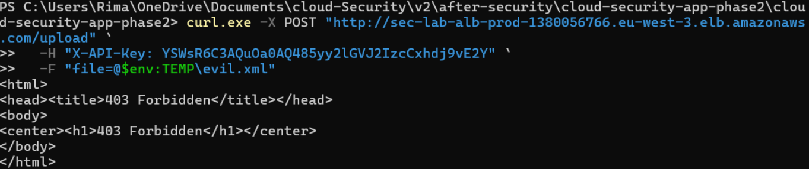
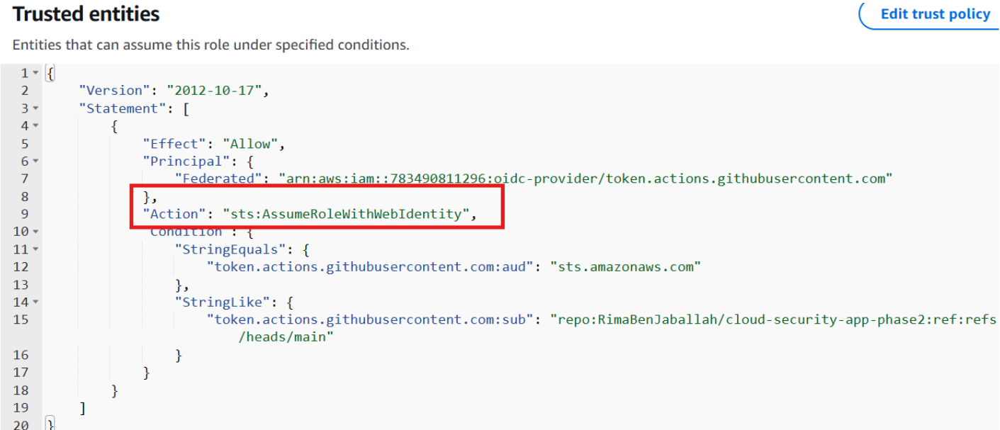

 # Remediation

Layer-by-layer hardening that closes both attack paths, with before/after code and validation evidence. All fixes are in Infrastructure-as-Code or application code — the `hardened/` trees in this repo — so the remediated state is reproducible, not manual.

> Identifiers below are sanitized placeholders.

## Findings register

| ID | Finding | Layer | Path | Status |
| --- | --- | --- | --- | --- |
| VULN-1 | XML parser resolves external entities (XXE→SSRF) | Application | 1 | Fixed |
| VULN-2 | API task role `s3:*`; no cross-tenant isolation | IAM / Storage | 1 | Fixed |
| VULN-5 | Verbose error/preview responses leak internals | Application | 1 | Fixed |
| VULN-6 | S3 versioning disabled | Storage | 1 | Fixed |
| — | `/tmp/cred_uri` debug write; lab-only routes | Application | 1 | Fixed |
| — | ECS security group open egress | Network | 1 | Fixed |
| F1 / F2 | Hardcoded IAM keys in Git history | CI/CD | 2 | Fixed |
| F3 | Deploy Role trust policy without conditions | IAM | 2 | Fixed |
| F4 | Deploy Role `secretsmanager:GetSecretValue` on `*` | IAM | 2 | Fixed |
| F5 | Detection Lambda rejected cross-account invokes | Detection | — | Fixed |

Plus defense-in-depth: WAF on the ALB, and a posture baseline (GuardDuty, Security Hub, IAM Access Analyzer).

---

## Application layer (Path 1 root cause)

### VULN-1 — Secure XML parsing

The parser is reconfigured so external entities, DTD loading, and parser network access are all disabled — blocking both the file read and the SSRF.

**Before** (`application/vulnerable/app.py`):
```python
parser = etree.XMLParser(
    resolve_entities=True,   # INSECURE
    no_network=False,        # INSECURE
    load_dtd=True,           # INSECURE
    dtd_validation=False,
    huge_tree=True,
)
```

**After** (`application/hardened/app.py`):
```python
parser = etree.XMLParser(
    resolve_entities=False,
    no_network=True,
    load_dtd=False,
    dtd_validation=False,
    huge_tree=False,
)
```

### Debug write, verbose responses, lab routes

- The `/tmp/cred_uri` startup write (which Path 1 Stage 1 read) is **removed**.
- Error handlers no longer return stack traces or exception detail; the parsed `preview` field (used to exfiltrate the credential data) is **removed** from the response. Errors are logged server-side and return generic messages.
- The lab-only routes `/admin/all-objects`, `/files/<s3_key>`, and `/lab/secrets-dump` are **deleted**.

---

## Network layer (Path 1 exfiltration)

### ECS egress lockdown

**Before** (`modules/network/main.tf`) — open egress:
```hcl
resource "aws_vpc_security_group_egress_rule" "ecs_all_out" {
  security_group_id = aws_security_group.ecs.id
  cidr_ipv4         = "0.0.0.0/0"
  ip_protocol       = "-1"
}
```

**After** — HTTPS only, plus PostgreSQL to the RDS security group only:
```hcl
resource "aws_vpc_security_group_egress_rule" "ecs_https_out" {
  security_group_id = aws_security_group.ecs.id
  cidr_ipv4         = "0.0.0.0/0"
  from_port         = 443
  to_port           = 443
  ip_protocol       = "tcp"
}

resource "aws_vpc_security_group_egress_rule" "ecs_to_rds" {
  security_group_id            = aws_security_group.ecs.id
  referenced_security_group_id = aws_security_group.rds.id
  from_port                    = 5432
  to_port                      = 5432
  ip_protocol                  = "tcp"
}
```

---

## IAM layer (Path 1 cross-tenant + Path 2 secret exfil)

### VULN-2 — API task role least privilege

**Before** (`modules/iam_api/main.tf`): `s3:*` on the entire bucket.
**After:** `s3:ListBucket` constrained to the known tenant prefixes, and `GetObject`/`PutObject` limited to `tenant-a/*`, `tenant-b/*`, `tenant-c/*`. No wildcard, no destructive actions.

```hcl
{
  Sid      = "ListKnownTenantPrefixes"
  Effect   = "Allow"
  Action   = "s3:ListBucket"
  Resource = var.tenant_data_bucket_arn
  Condition = { StringLike = { "s3:prefix" = [
    "tenant-a", "tenant-a/*", "tenant-b", "tenant-b/*", "tenant-c", "tenant-c/*"
  ] } }
},
{
  Sid    = "ReadWriteKnownTenantObjects"
  Effect = "Allow"
  Action = ["s3:GetObject", "s3:PutObject"]
  Resource = [
    "${var.tenant_data_bucket_arn}/tenant-a/*",
    "${var.tenant_data_bucket_arn}/tenant-b/*",
    "${var.tenant_data_bucket_arn}/tenant-c/*"
  ]
}
```

### F3 — Deploy Role trust via OIDC

**Before** (`modules/iam_cross_account/main.tf`) — trusts an IAM user with no conditions:
```hcl
Principal = { AWS = "arn:aws:iam::${var.dev_account_id}:user/sec-lab-pipeline-user-dev" }
Action    = "sts:AssumeRole"
```

**After** — trusts GitHub's OIDC provider, restricted to a specific repo and branch:
```hcl
Principal = { Federated = var.github_oidc_provider_arn }
Action    = "sts:AssumeRoleWithWebIdentity"
Condition = {
  StringEquals = { "token.actions.githubusercontent.com:aud" = "sts.amazonaws.com" }
  StringLike   = { "token.actions.githubusercontent.com:sub" =
    "repo:${var.github_repository}:ref:refs/heads/${var.github_branch}" }
}
```

### F4 — Deploy Role scoped

The wildcard `secretsmanager:GetSecretValue` on `*` policy is **deleted entirely** — deploying an image and updating a service needs zero Secrets Manager access. ECR and ECS permissions are scoped to the repository/service, and `iam:PassRole` is conditioned to `ecs-tasks.amazonaws.com`.

### `:latest` image tag removed

The ECS task definition no longer falls back to the mutable `:latest` tag; CI/CD deploys commit-SHA-pinned images (`${{ github.sha }}`), so a deploy is always tied to an immutable, known artifact.

---

## CI/CD layer (Path 2 root cause)

### F1 / F2 — OIDC instead of hardcoded keys

**Before** (`application/vulnerable/.github/workflows/deploy.yml`) — static keys in the workflow:
```yaml
env:
  AWS_ACCESS_KEY_ID: "AKIA...EXAMPLE"
  AWS_SECRET_ACCESS_KEY: "...EXAMPLE"
```

**After** (`.github/workflows/deploy.yml`) — short-lived OIDC token, no stored secret:
```yaml
permissions:
  id-token: write
  contents: read
# ...
- name: Configure AWS credentials with GitHub OIDC
  uses: aws-actions/configure-aws-credentials@v4
  with:
    role-to-assume: ${{ env.DEPLOY_ROLE_ARN }}
    aws-region: ${{ env.AWS_REGION }}
```

### Secret scanning in CI

A `secret-scan.yml` workflow runs **gitleaks** over full history on every push and pull request, so a re-introduced secret is caught before merge. This workflow needs no AWS credentials and runs safely on a public repo.

---

## Storage layer

### VULN-6 — S3 versioning + guardrail policy

Versioning is enabled (so tampering is recoverable), and a bucket policy denies any non-TLS request and denies object actions outside the three tenant prefixes — a defense-in-depth boundary that holds even if an IAM policy regresses.

```hcl
resource "aws_s3_bucket_versioning" "this" {
  bucket = aws_s3_bucket.this.id
  versioning_configuration { status = "Enabled" }
}
# Bucket policy: Deny non-TLS (aws:SecureTransport=false) and
# Deny Get/Put/DeleteObject on NotResource outside tenant-a/b/c prefixes.
```

---

## Detection layer

### F5 — Fix the cross-account forwarder permanently

**Before** (`modules/logging_security/main.tf`, line 143):
```hcl
source_account = var.security_account_id   # wrong — drops all prod events
```

**After:**
```hcl
source_account = var.prod_account_id
```

The Logs Destination always invokes the forwarder on behalf of the **source-event** account (prod), so the policy must trust prod. This was originally patched by CLI during testing, but the fix belongs in Terraform or the next `apply` reverts it.

### SNS notifications on alarms

The three existing metric-filter alarms now publish to an SNS topic (with an email subscription), so detection is actionable rather than console-only.

---

## Beyond the known paths (defense-in-depth)

- **WAF on the ALB** (`modules/waf`) — AWS managed rule sets (common, known-bad-inputs, IP reputation) plus a per-IP rate limit. Scoped honestly: WAF does not block the Path 1 XXE (the attacker authenticates as a real tenant and the payload is inside multipart form-data) — it protects the unauthenticated perimeter.
- **Security posture baseline** (`modules/posture`) — GuardDuty, Security Hub (AWS Foundational Security Best Practices), and IAM Access Analyzer, enabled in prod to catch drift and flag over-broad policies going forward.

---

## Validation

| Check | Result |
| --- | --- |
| Path 1 Stage 1 (read `/tmp/cred_uri`) | Fails — file removed **and** parser refuses external entities |
| Path 1 Stage 3 (cross-tenant S3) | Fails — IAM scoped to tenant prefixes + bucket policy denies cross-prefix |
| Path 2 Phase 2 (assume Deploy Role) | Fails — trust policy requires an OIDC token; leaked IAM keys are invalid |
| Path 2 Phase 4 (mass secret read) | Fails — wildcard secrets policy deleted |
| Detection chain | Verified end-to-end after F5 fix; alarms fire on attack signatures |

  
